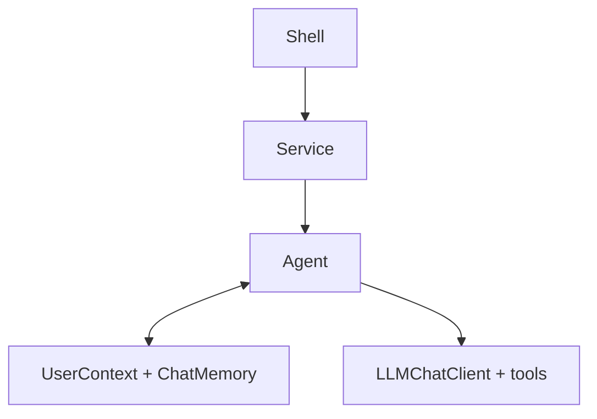
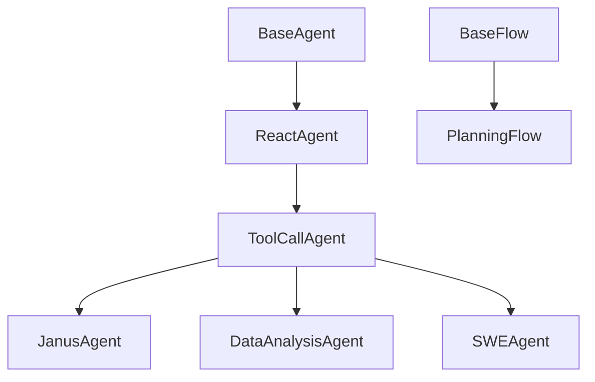
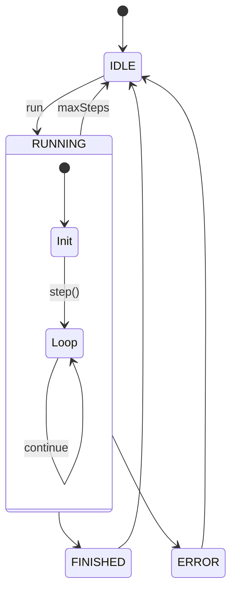
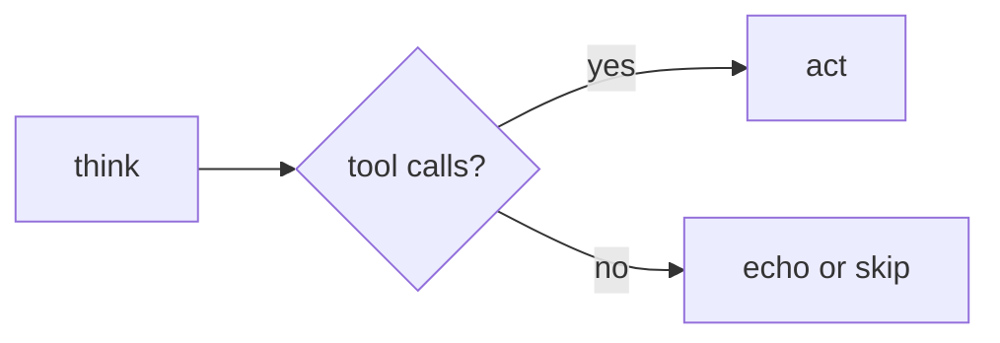
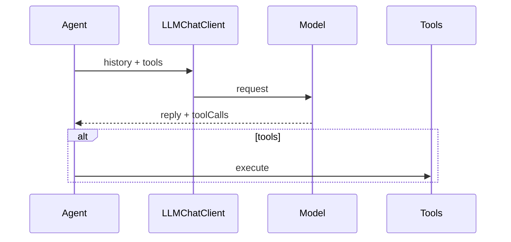
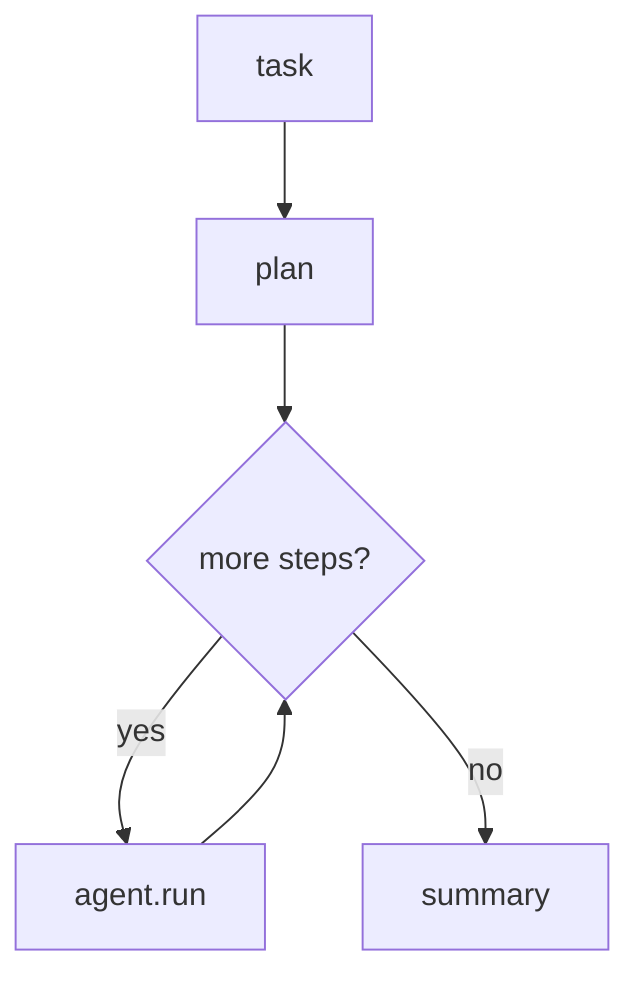
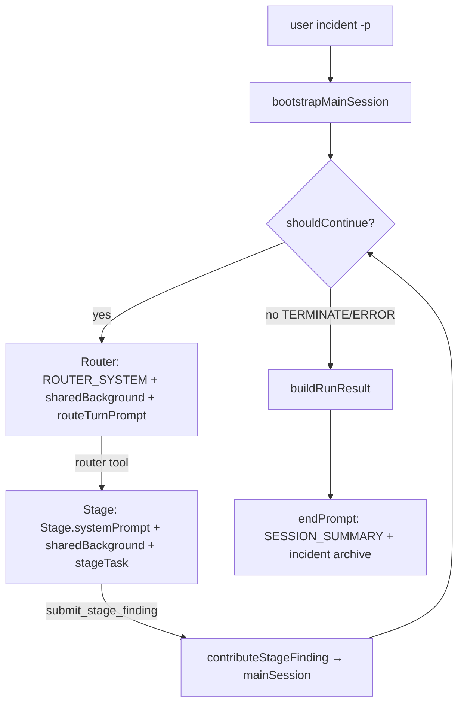

# Agent framework and flows

> [中文](AGENT-FLOW.md) · Shell usage: [shell/docs/SHELL.en.md](../../shell/docs/SHELL.en.md) · FAQ: [docs/FAQ.en.md](../../docs/FAQ.en.md)

Janus **core** ships agents and flows; **shell** is the CLI. Below: what an agent is, then structure and flow diagrams in execution order.

---

## What is an agent?

In Janus, an **agent** completes a user **request** in multiple steps: it talks to the LLM, optionally **calls tools** (Python, files, bash, charts, etc.), and stops when the task looks done or `maxSteps` is reached.

Each iteration follows the same pattern:

1. **Understand** the goal (system prompt + conversation history);
2. **Decide** this step’s action—reply only, or call a tool;
3. **Execute**, store results in memory, continue.

This is **ReAct** (reason then act). All task agents share that loop; they differ in **tools** and **prompts**.

A single call `agent.run(context, request)` returns lines like `Step 1:`, `Step 2:`—one per iteration. Integrators do not assemble model requests or parse tool calls themselves.

For work that must be **split across specialized agents**, core also provides **Flow** (see PlanningFlow below).

---

## Where agents sit in the stack

A typical path: **Shell command → Service → Agent → model and tools**. The agent handles reasoning and tool orchestration; the service picks the model and stores conversation history.



How the CLI calls `agent.run` is in [SHELL.en.md](../../shell/docs/SHELL.en.md).

---

## Code structure

Agents form an inheritance chain: upper layers control the run loop; lower layers handle tool calls.



- **BaseAgent**: `run` loop, state, step limit.
- **ReactAgent**: each step is `think` then optional `act`.
- **ToolCallAgent**: Spring AI tool calling; Janus / DA / SWE swap tools and prompts.
- **PlanningFlow**: schedules multiple agents from a plan—it does not replace them.

---

## Agent variants

| Agent | CLI group | Best for | Main tools |
|-------|-----------|----------|------------|
| **ToolCallAgent** | `tool-call` | Minimal chat | `create_chat_completion`, `terminate` |
| **JanusAgent** | `janus` | General work | `plan`, Python, file editor, `ask_human`, `terminate` |
| **DataAnalysisAgent** | `da` | Tables, stats, charts | Python, chart prep, visualization, `terminate` |
| **SWEAgent** | `swe` | Terminal coding | `bash`, `str_replace_editor`, `terminate` |

Optional **MCP tools**. Limits like `max-steps` are configured per agent (Shell: [SHELL.en.md](../../shell/docs/SHELL.en.md)).

---

## What one `run` does

After `agent.run(context, request)`, the agent writes the system prompt and user message on first use (**S**, **U₀**), then loops `step` until finished or out of steps.



**`terminate`** usually ends the run cleanly; otherwise the loop may stop at `maxSteps`. Repeated assistant text triggers a recovery hint to reduce spinning.

---

## Each step: think and act

**ReactAgent** splits a step into **think** then **act**.

- **think**: send history and tool definitions to the model; get text and optional tool calls (**Aₙ**).
- **act**: run tools and write results (**Tₙ**); **`terminate`** ends the whole run. With no tools, step text may be echoed as output.





A short **nextStepPrompt** (**Uₙ**) may be injected before each think; wording is per agent class.

---

## Message symbols

| Symbol | Meaning |
|--------|---------|
| **S** | System prompt |
| **U₀** | This run’s `request` |
| **Uₙ** | Next-step hint before think |
| **Aₙ** | Assistant reply |
| **Tₙ** | Tool result |

With tools: `… → Uₙ → Aₙ → Tₙ`.

---

## PlanningFlow

Use **PlanningFlow** when you need a **plan first**, then different agents per step (wired in code; no Shell command yet).

Build a **Plan** → for each pending step, pick an executor agent → `agent.run` for that step → mark done → finalize.



The plan drives **what** runs next and **which** agent runs it—not free-form tool picking inside one long `run`.

---

## Prompt design and optimization

Janus prompts follow structured patterns from the [Prompt Engineering Guide — Examples of Prompts](https://www.promptingguide.ai/introduction/examples.en#text-summarization), while respecting **prefix cache** and **session memory** constraints.

### Structured elements

Split each prompt into clear blocks instead of mixing role, task, background, format, and constraints in one paragraph:

| Block | Purpose | Typical placement |
|-------|---------|-------------------|
| **Role** | Persona and domain (role prompting) | Start of system prompt |
| **Instruction** | What to do this step | System / user / nextStep |
| **Context** | Read-only background (history, progress, plan status) | User message |
| **Input** | Content to process (user text, trace, snapshot) | User message |
| **Output** | Expected deliverable or tool usage | System prompt; append `Summary:` for summarization user messages |
| **Rules** | Language, no fabrication, tool limits, convergence | System / nextStep |

Question-answering style (Context + question + `Answer:`) and summarization style (Instruction + Input + `Summary:`) are used for session summaries and plan finalization.

Example (session summary system prompt):

```text
Instruction: Summarize one completed agent task for long-term session memory.
Input: User request and agent trace will follow in the user message.
Output: Write 2-5 concise sentences covering:
- What was requested
- What was done
- The outcome
Rules: Use the same language as the user's request. Do not include raw logs or stack traces.
```

### Prompt layers

| Type | Lifetime | Where defined | Notes |
|------|----------|---------------|-------|
| **systemPrompt (S)** | Fixed per request | Agent classes, `DiagnosticPrompts`, `Stage` | Role + Instruction + Output/Rules |
| **primary user request (U₀)** | Current task | CLI `-p` / API | Placed at the front of the prefix |
| **trailing user blocks** | Variable per request | `PromptPrefixLayout.build(..., trailingUserBlocks)` | Router snapshots, stage background, etc. |
| **nextStepPrompt (Uₙ)** | **Ephemeral** | `NEXT_STEP_PROMPT`, `Stage.nextStepPrompt()` | Single-step guidance; not stored in session by default |
| **session summary prompt** | Cross-turn | `sessionSummarySystemPrompt()`, `DiagnosticPrompts` | Compressed by `PromptRunSummarizer` to two messages per turn |

Guidelines:

- Put **stable, cache-friendly text in the prefix**; put **request-specific data at the tail**.
- Deliver user-visible answers via **`create_chat_completion`** (Janus / tool-call) or **`submit_stage_finding`** (diagnostic), then **`terminate`** on a later step.
- For classification (`classify_incident`, etc.), spell out label semantics in **Instruction**; add few-shot examples when output format must be exact (same idea as sentiment examples in the Guide).

### Prefix order and prompt cache

`PromptPrefixLayout` fixes message order for **prefix cache** reuse:

```text
S → U₀ (current task) → trailing user blocks → session framing → prior summaries → A/T (step loop)
```

- **Current task stays directly under S** so the system + task prefix stays stable within a session; only the tail (snapshots, history) changes.
- **SESSION_HISTORY_FRAMING** sits before hydrated history and states that messages above are the current task and messages below are background only—reduces misreading old summaries as new instructions.
- In diagnostic, Router and Stage **share** `sharedInvestigationBackground` (user request + prior session + `state.desc()`) as the primary user block; **phase-specific prompts** (`routeTurnPrompt` / `stageTaskUserPrompt`) follow in trailing blocks.

Implementation: `core/src/main/java/com/wish/models/context/PromptPrefixLayout.java`.

### Diagnostic module

The diagnostic flow differs from a single-agent `run`: a **router + multiple stages** cooperate across **three isolated contexts**. Code lives under `diagnostic/`; CLI usage is in [shell/docs/SHELL.en.md](../../shell/docs/SHELL.en.md#example-diagnostic-incident-investigation).

#### Three contexts and prompt roles

| Context | Storage | System (S) | Main user content | Persists across steps |
|---------|---------|------------|-------------------|------------------------|
| **Main session** | `DiagnosticContext.mainSession` (`List<Message>`, not ChatMemory) | `DIAGNOSTIC_SYSTEM` | `initialIncidentPrompt` (U₀) + `stageFindingMessage` per stage | **Session summarization**; not the direct LLM background for Router/Stage |
| **Router** | `routeChatMemory` (separate partition) | `ROUTER_SYSTEM` | `sharedInvestigationBackground` + `routeTurnPrompt` (reset each route) | **One route call**; `prepareRouteStageContext()` rebuilds prefix each turn; no accumulated route chat |
| **Stage** | `stageChatMemory` (new partition per stage) | `Stage.systemPrompt` | `sharedInvestigationBackground` + `stageTaskUserPrompt` (+ report hint) | **This stage only**; cleared in `endStage()` |

Boundary rules (`DiagnosticContext`):

- **Router and Stage share the same background**: `formatSharedInvestigationBackground()` (user request, prior session summaries, `State.desc()`); only the trailing phase prompt differs (`routeTurnPrompt` vs `stageTaskUserPrompt`).
- Stage tool traces **do not** write back to main session; only **`submit_stage_finding`** contributes conclusions to main session and `State`.
- **Main session** is the narrative investigation record (for Session compression), separate from the shared structured background used by Router/Stage.
- Multi-turn `-s` embeds prior turn summaries in `sharedInvestigationBackground` (`Context — prior session`); `bootstrapMainSession` also hydrates them into the tail of main session.

#### Investigation loop



Router prefix each turn (`prepareRouteStageContext` + `PromptPrefixLayout`):

```text
S (ROUTER_SYSTEM) → U_shared (sharedInvestigationBackground) → U_route (routeTurnPrompt) → A/T (this route call)
```

Stage prefix (`StageProcessor` + `ToolCallAgent.run`):

```text
S (Stage.systemPrompt) → U_shared (sharedInvestigationBackground) → U_stage (stageTaskUserPrompt + report hint) → Uₙ/A/T (step loop)
```

Within one investigation loop iteration, `routeStage` and `handleStage` see the **same** `U_shared` (same `State` at that moment). Router memory resets each turn and does not accumulate prior route dialogue.

#### `DiagnosticPrompts` constants

| Constant / method | Role |
|-------------------|------|
| `DIAGNOSTIC_SYSTEM` | Main-session coordinator; separates problem type vs root cause |
| `ROUTER_SYSTEM` | Stage routing; `router` tool only |
| `sharedInvestigationBackground` | **Shared** Router/Stage background (user request, prior session, `state.desc()`) |
| `routeTurnPrompt` | Route-specific trailing (instruction + last stage outcome) |
| `initialIncidentPrompt` | Formats first user request as main-session U₀ |
| `stageTaskUserPrompt` | Stage-specific trailing (stage task + router rationale) |
| `stageFindingMessage` | Template when a stage finding is appended to main session |
| `SESSION_SUMMARY_SYSTEM` | Multi-turn session compression (`DiagnosticSession`) |
| `reportPersistHint` / `persist_incident_report` | TERMINATE: LLM-driven `incident-report.md` (`IncidentReportTool`) |

Structured tools (output contract):

| Tool | Stage | Meaning |
|------|-------|---------|
| `router` | Router | Choose next `Stage` |
| `classify_incident` | CLASSIFY | **Problem type** (symptom, not root cause); enum from `IncidentCategory.catalogForPrompt()` |
| `classify_root_cause` | COLLECT onward | **Root cause**; updatable; enum from `IncidentRootCause.catalogForPrompt()` |
| `submit_stage_finding` | Each stage | Stage deliverable (diagnostic equivalent of `create_chat_completion`) |
| `persist_incident_report` | TERMINATE (when reports enabled) | Create/update single markdown incident report file |
| `terminate` | Each stage | End stage agent run |

`StageToolCallAgent` sets `directSessionResultTool` to `submit_stage_finding`; the summarizer prefers that over assistant text.

#### Stage prompts

Each `Stage` enum defines:

| Type | Source | Notes |
|------|--------|-------|
| **Stage system** | `Stage.systemPrompt` | Role + Instruction + Rules + Output (e.g. CLASSIFY: problem type only) |
| **Step nextStep** | `Stage.nextStepPrompt()` | Ephemeral; one action per turn; `submit_stage_finding` then `terminate` |

Typical router path: `INITIAL → CLASSIFY → COLLECT → ANALYZE → VALIDATE → TERMINATE | ERROR`.

Classification design (Guide-style):

- **Problem type** and **root cause** use separate stages and tools so CLASSIFY does not over-attribute root cause.
- Enum catalogs are embedded in Instructions; add few-shot in CLASSIFY when label format must be exact.

#### Summarization and incident report

| Path | When | Output |
|------|------|--------|
| Session continuation | `DiagnosticSession.endPrompt` + `SESSION_SUMMARY_SYSTEM` | 2 summary messages per turn in ChatMemory (`PromptRunSummarizer`) |
| Incident report file | TERMINATE agent calls `persist_incident_report` | Single `incident-report.md` under `~/.janus/diagnostic-reports/` (`IncidentReportStore`) |

Session input: `getPromptMessagesForSummary()` (main-session delta this run) + run result. Incident report is maintained by the agent in TERMINATE, not auto-archived at service end; toggle via `janus.diagnostic.reports-enabled` or `--reports`.

#### Editing diagnostic prompts

1. Shared background → `sharedInvestigationBackground`; phase prompts → `routeTurnPrompt` / `stageTaskUserPrompt`; stage behavior → `Stage` enum or `Stage.nextStepPrompt()`.
2. Keep **shared background (primary) before phase prompts (trailing)**; separate **user request** (shell input) from **incident report** (persisted markdown file).
3. Stage conclusions must go through **`submit_stage_finding`**, not assistant-only text into main session.
4. Run `diagnostic` module tests; core `PromptPrefixLayoutTest` still covers shared prefix layout.

### Where prompts live in code

| Area | Main files |
|------|------------|
| Generic / Janus / SWE / DA agents | `core/.../agent/*.java`, `ToolCallAgent.java` |
| Planning flow | `core/.../flow/PlanningFlow.java` |
| Session summarization | `PromptRunSummarizer.java` + per-agent `SESSION_SUMMARY_*` |
| Diagnostic prompts / stages | `diagnostic/.../prompt/DiagnosticPrompts.java`, `model/stage/Stage.java` |
| Diagnostic context boundaries | `diagnostic/.../model/DiagnosticContext.java` |
| Diagnostic execution loop | `diagnostic/.../loop/DiagnosticAgent.java`, `StageProcessor.java`, `StageToolCallAgent.java` |
| Diagnostic session / incident report | `diagnostic/.../models/session/DiagnosticSession.java`, `models/report/IncidentReportStore.java`, `tools/IncidentReportTool.java` |

When adding or editing prompts:

1. Use **Role → Instruction → Output/Rules** (system) or **Instruction → Context/Input → Summary:** (summarization user messages).
2. Keep **U₀ short**; put large read-only material in trailing blocks or Context sections labeled `read-only`.
3. **nextStepPrompt** should describe **one best action per turn**; put convergence rules (e.g. terminate after `create_chat_completion`) under **Rules**.
4. Run related tests: `PromptPrefixLayoutTest`, `AgentSessionSummaryPromptTest`, `PromptRunSummarizerTest`; diagnostic tests in the `diagnostic` module.

### Working with memory

- **Stored in session**: compressed user request + agent result per prompt (and diagnostic incident reports)—not full step traces.
- **Not stored in session**: `nextStepPrompt`, ephemeral routing/stage hints, raw tool logs (omitted by summary Rules).
- Continuation issues (treating “continue” or framing text as a new task) often mean stale session data; use `clear-session`. See [FAQ.en.md](../../docs/FAQ.en.md).

---

## Extending

| Goal | Approach |
|------|----------|
| New tool | `@Tool` method + `builtinTools` |
| New agent | Subclass `ToolCallAgent` |
| New CLI | `*Service` + `*Command` |

Packages: `com.wish.agent`, `com.wish.flow`, `com.wish.tools`, `com.wish.llm`.