# Agent 框架与流程

> [English](AGENT-FLOW.en.md) · 排错：[docs/FAQ.md](../../docs/FAQ.md)

本文介绍 Janus **core** 中 Agent 的定义、分类与执行流程，不涉及 CLI 入口与实现细节。

---

## Agent 定义

在 Janus 中，**Agent** 指一类面向任务的多步执行单元：接收自然语言目标后，在限定 **max steps** 内反复 **think → act**，按需发起 **tool call**，直至任务完成或达到步数上限。

其核心行为模式为 **ReAct**（Reason + Act）：

1. **Reason（think）**：结合 **system prompt**、历史 **Memory** 与当前 **Context**，判断本步最优动作；
2. **Act**：执行 **tool call**（或输出 assistant 文本），将结果写回 **Memory**，供后续 step 使用。

除单 Agent 的 `run` 外，core 还提供 **PlanningFlow**：先将任务分解为 **Plan**，再按步骤分派至不同 Agent 执行。

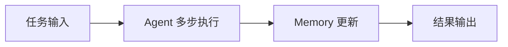

---

## 架构位置

从 core 视角，单次请求的处理链路为：**任务输入 → Agent step loop → Memory 沉淀 → 结果输出**。

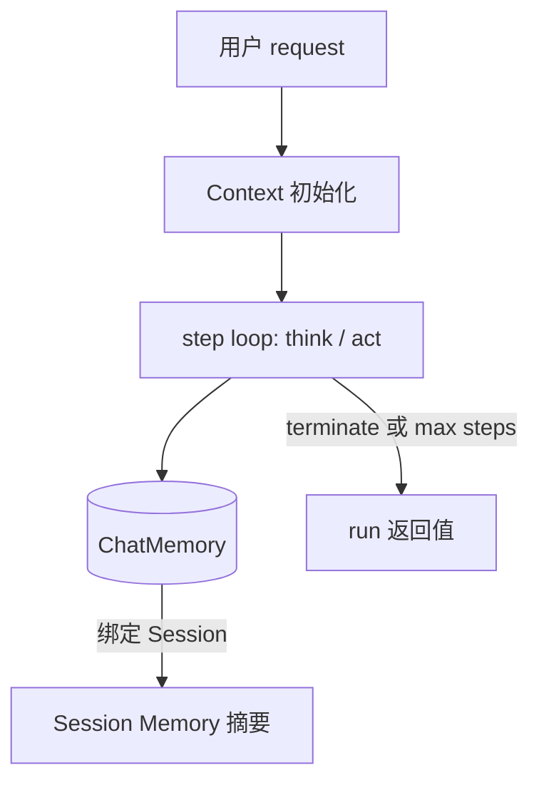

---

## Agent 分类

core 预置四类 Agent 实现，面向不同任务域；均继承 **ToolCallAgent** 的 multi-step 范式，差异体现在 **decision policy** 与 **built-in toolset**。

| 分类 | 实现类 | 适用场景 | Built-in Tools | 典型产出 |
|------|--------|----------|----------------|----------|
| 基础对话 | `ToolCallAgent` | 最小问答闭环 | `create_chat_completion`, `terminate` | 结构化答复并结束 |
| 通用任务 | `JanusAgent` | 规划、脚本、文件、人机协作 | `plan`, `python_execute`, `str_replace_editor`, `ask_human`, `create_chat_completion`, `terminate` | 分步执行后的汇总结论 |
| 数据分析 | `DataAnalysisAgent` | 统计、可视化 | `python_execute`（analysis）, `visualization_prepare`, `data_visualization`, `terminate` | 分析报告与图表文件 |
| 工程执行 | `SWEAgent` | 代码阅读、修改、命令验证 | `bash`, `str_replace_editor`, `terminate` | 可验证的工程变更 |

> **可选扩展**：各 Agent 均可叠加 **MCP tools**；当配置目录下存在 `SKILL.md` 时，还可注入 **skills tools**（`Skill`、`Read`、`Shell` 等）。详见 [Skills 机制](#skills-机制)。

---

## 执行生命周期与 Agent Flow

Agent 自 **IDLE** 接收任务后进入 **RUNNING**，在 **step loop** 中推进；正常结束为 **FINISHED**（通常由 `terminate` 触发），异常为 **ERROR**，或达到 **max steps** 后回到 **IDLE**。

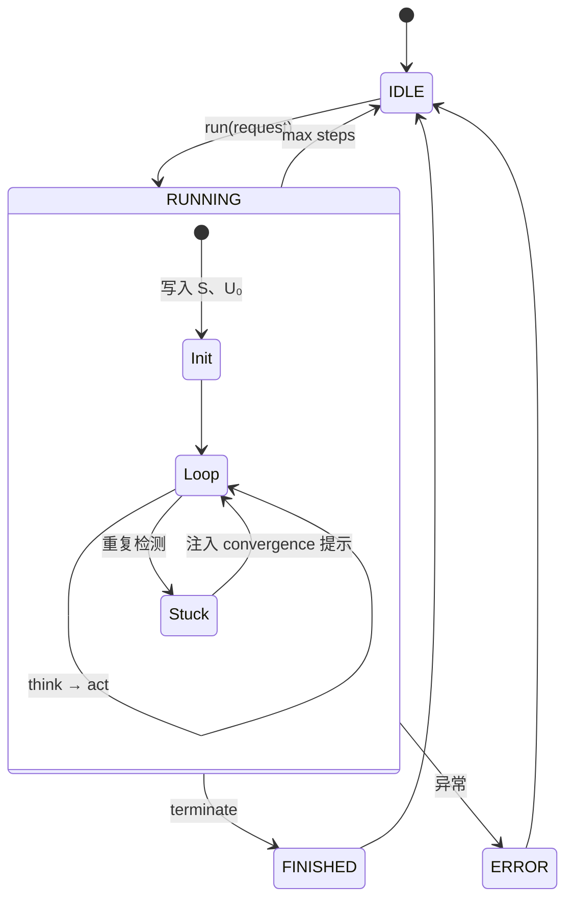

### 通用单步机制：think 与 act

每个 **step** 由 **think** 与 **act** 两阶段组成：

| 阶段 | 职责 | 写入 Memory |
|------|------|-------------|
| **think** | 调用 LLM，生成 `Aₙ`（含可选 tool calls） | 持久化 `Aₙ`（部分 Agent 对 assistant-only 有特殊策略） |
| **act** | 执行 tool calls 或返回 assistant 文本 | 有 tool 时写入 `Tₙ` 并更新 history |

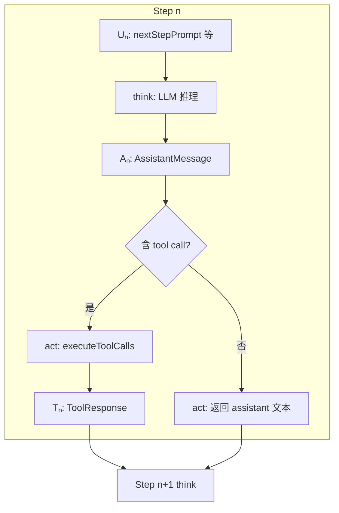

### 对话消息符号

阅读日志、Memory 或下文流程图时，采用下列符号指代消息类型：

| 符号 | 类型 | 说明 |
|------|------|------|
| **S** | SystemMessage | 系统提示（`systemPrompt`） |
| **U₀** | UserMessage | 本轮用户 **request** |
| **Uₙ** | UserMessage | 第 n 步 **nextStepPrompt**（ephemeral，默认不持久化） |
| **Aₙ** | AssistantMessage | 模型回复；可含 **tool calls** |
| **Tₙ** | ToolResponseMessage | **tool call** 执行结果 |

**单步含 tool 时的 Memory 序列**：

```text
… → Uₙ → Aₙ(tool_calls) → Tₙ
```

**与运行日志的对应关系**：

| 日志字段 | 对应符号 |
|----------|----------|
| `{Agent}'s thoughts` | `Aₙ` 文本部分 |
| `Tool prepared: {name}` | `Aₙ` 中的 tool call |
| `Tool {name} result` | `Tₙ` |
| `Step n: …`（CLI 输出） | 本 step **act** 返回值 |

### 按 Agent 分类的执行流程

以下给出各类 Agent 的典型 **message pattern** 与流程图；实际轨迹因模型决策而异，图中为最常见路径。

### ToolCallAgent（基础对话）

**目标**：通过 `create_chat_completion` 交付用户可见答案，再 `terminate` 结束。

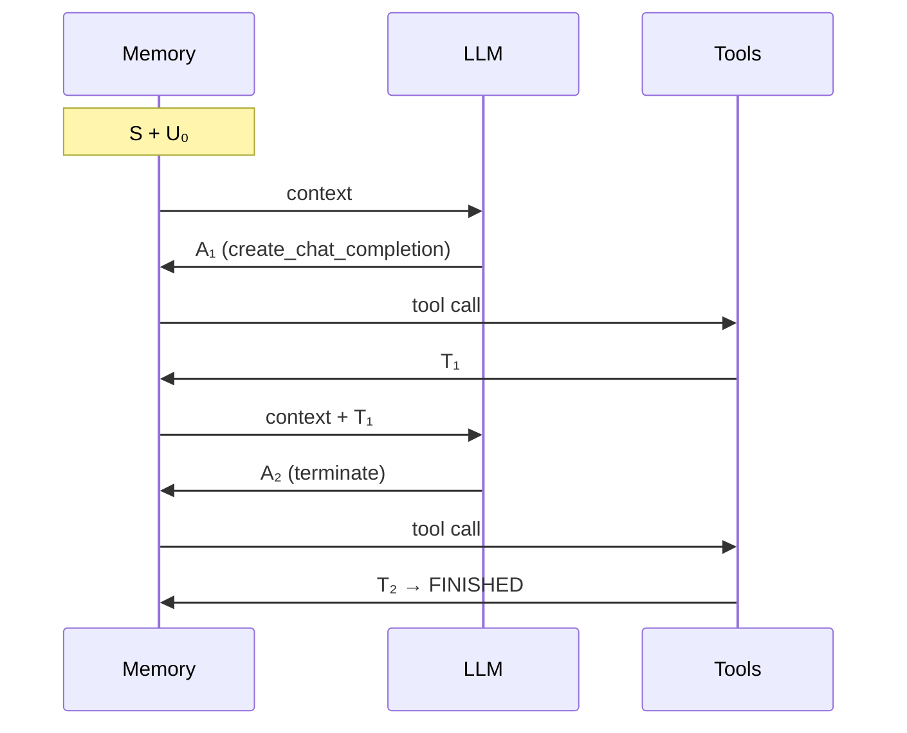

---

### JanusAgent（通用任务）

**目标**：在多工具间编排，最终以 `create_chat_completion` 收口。

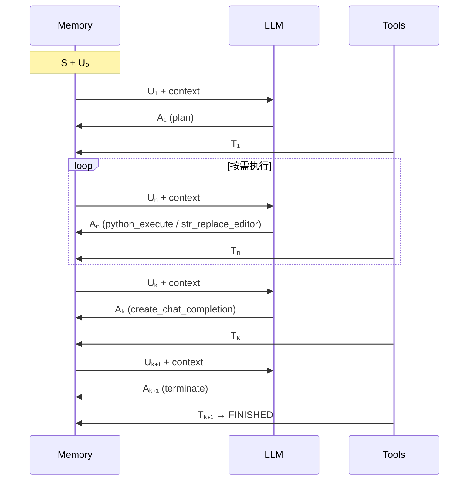

**说明**：`T₁…Tₙ₋₁` 多为中间产物（计划状态、脚本输出、编辑结果）；面向用户的最终交付集中在 `create_chat_completion` 对应的 **Tₖ**。

---

### DataAnalysisAgent（数据分析）

**目标**：完成数据处理与可视化后输出 **analysis conclusion**。

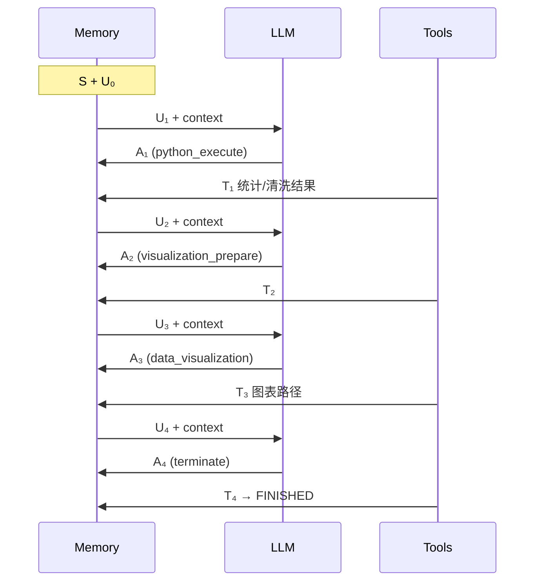

---

### SWEAgent（工程执行）

**目标**：在 **workspace** 内完成读文件、改代码、跑命令与验证；可选通过 **skills** 加载领域规则。

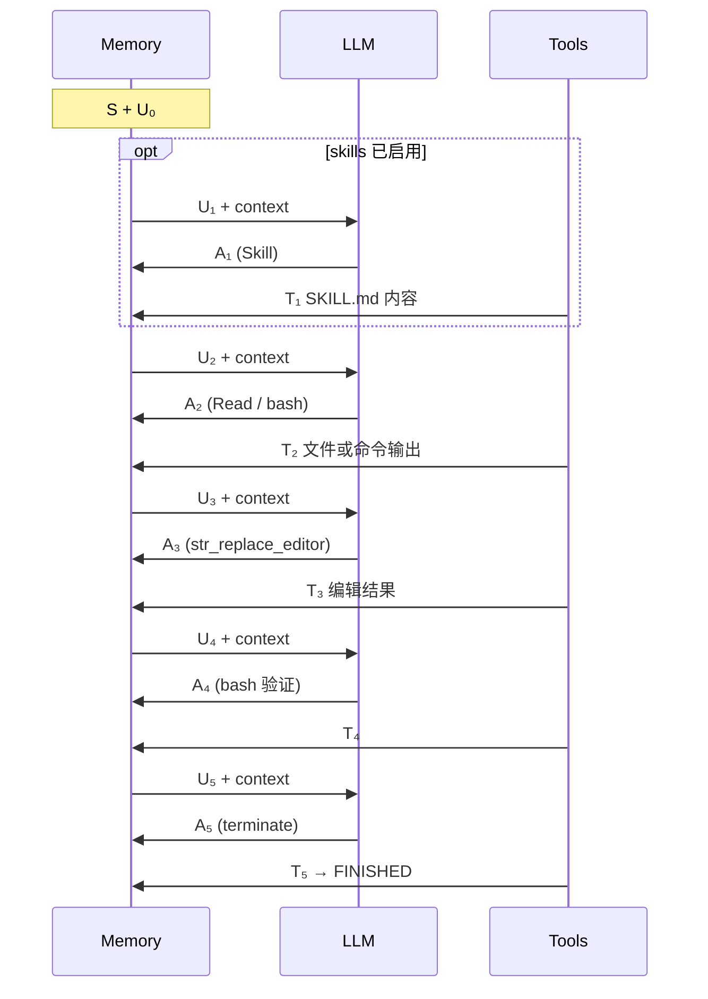

**说明**：若出现连续 **assistant-only** 的 `Aₙ`（无 tool call），表示模型在复述结论而未收敛；应通过 **nextStepPrompt** 约束「完成后仅调用 `terminate`」。工程 Agent 的 **NEXT_STEP_PROMPT** 已包含此类 **convergence** 规则。

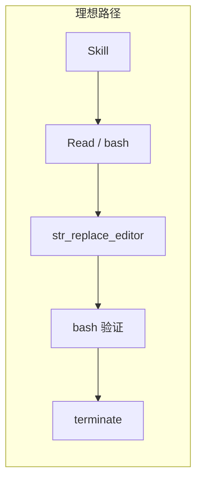

---

## Skills 机制

Janus 支持通过 **`SKILL.md`** 为 Agent 注入领域指令；当配置目录下存在至少一个 `SKILL.md` 时，自动注册 **skills tools**，否则 skills 能力整体关闭。

### 目录约定

采用「全局 + Agent 专属」两层配置：

| 配置项 | 含义 |
|--------|------|
| `janus.agent.default.skills.dir` | 全局通用技能（如 `.agent/default/skills`） |
| `janus.agent.<agent>.skills.dir` | 某 Agent 专属技能（如 `.agent/swe/skills`） |

每个技能子目录下需包含 **`SKILL.md`**。

### 注入的 Tools

| Tool | 来源 | 作用 |
|------|------|------|
| `Skill` | `SkillsTool` | 加载指定技能说明 |
| `Read` 等 | `FileSystemTools` | 读取文件 |
| Shell 相关 | `ShellTools` | 命令执行 |

skills 工具与 built-in tools 共用同一 **think → act** 链路，消息序列仍为 `Uₙ → Aₙ → Tₙ`。

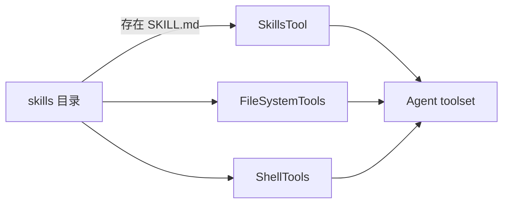

---

## 规划编排 Flow

当任务需**先分解计划、再分派至不同 Agent** 时，使用 **PlanningFlow**（与单 Agent `run` 并列）。

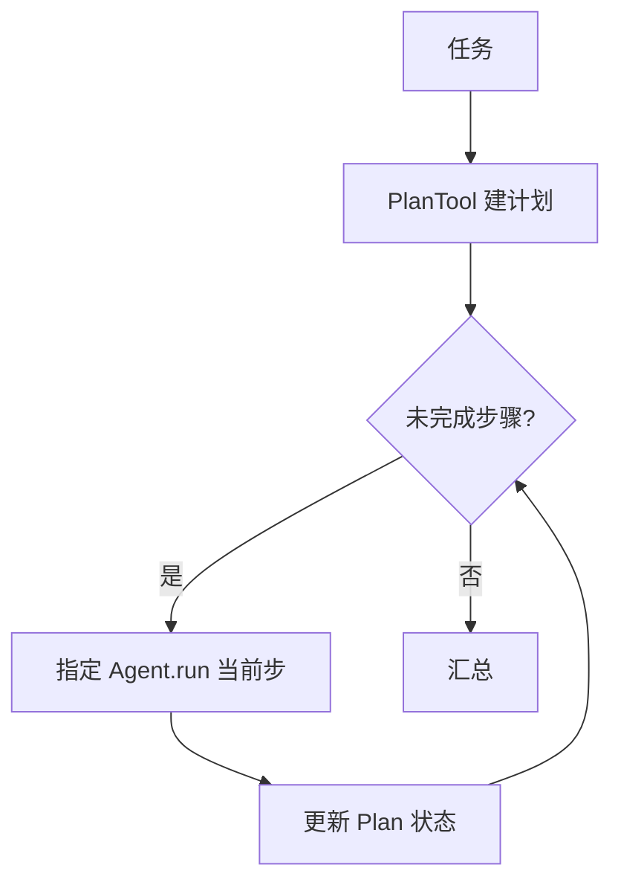

与单 Agent 的差异：**下一步执行者与动作**由 **Plan** 驱动，而非同一 Agent 在单步内连续自选多个 tool。

---

## Session、Context 与 Memory

| 概念 | 粒度 | 职责 |
|------|------|------|
| **Session** | 跨多次 request | 维持任务连续性；可写入 session-level 摘要 |
| **Context** | 单次 request | 承载本轮 think/act 中间状态（如 `currentChatPrompt`） |
| **Memory** | step / turn / session | 对话历史的分层沉淀 |

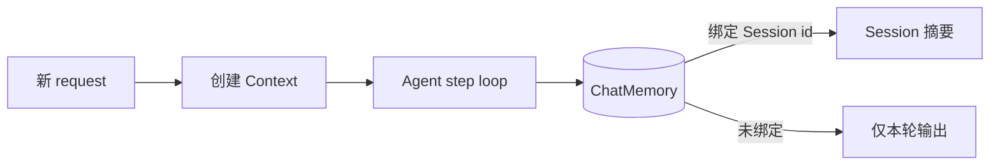

### Session 运行机制（更具体）

在 shell service 中，`sessionId` 是否传入会决定两条不同路径：

| 场景 | 运行路径 | 行为 |
|------|----------|------|
| 传入 `sessionId`（如 `-c demo`） | `runPersistent` | 复用/创建 `ToolCallSession`，结束后将本轮摘要写入 session memory |
| 未传入 `sessionId` | `runEphemeral` | 创建一次性 context，执行后立即清理 chat memory，不保留跨轮状态 |

#### 1) Session 的创建与复用

- `sessionId` 会先标准化（trim；空字符串视为无 session）；
- 持久会话的 key 由 `modelKey + ":" + sessionId` 组成；
- 同 key 会复用同一个 `ToolCallSession`，不同 model 或不同 sessionId 互相隔离；
- 首次创建会话时，会绑定当前 agent 的 `summarySystemPrompt`，用于后续摘要提取。

#### 2) 每轮请求如何“继承历史”

- `beginPrompt(request)` 会先把 session memory 中已沉淀的消息 hydrate 到本轮 `ToolCallUserContext`；
- 本轮 step loop 在此基础上继续追加 `U₀ / Aₙ / Tₙ`；
- 因此同一 session 的后续请求能够看到前序关键结论，而非从空白上下文开始。

#### 3) 每轮结束如何“写回 session”

- `endPrompt(runResult)` 会触发 `PromptRunSummarizer`：
  - 输入：本轮 request + 本轮 prompt messages + runResult；
  - 输出：精简的 user request / agent result 摘要；
- 仅当摘要非空时，才写入 session memory（通常是一对 `UserMessage + AssistantMessage`）；
- 目标是保留可复用结论，避免将每一步临时推理与噪声原样累积到长会话。

#### 4) 失败与清理

- 若本轮抛异常，仍会执行 `endPrompt()`（无 runResult 版本）做收尾；
- 显式清理会话（`clearSession`）会删除会话缓存与对应 memory，并清理该会话下的 bash session；
- ephemeral 路径每次执行后都会 `chatMemory.clear(contextId)`，确保一次性请求不残留状态。

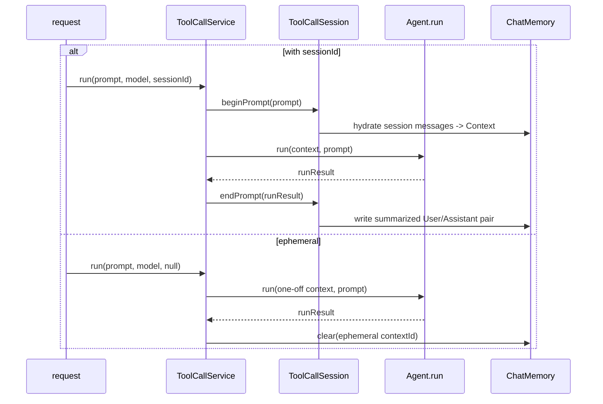

### Memory 分层

- **step-level**：服务于下一步 **think**，生命周期最短；
- **turn-level**：保留本轮关键 **U₀ / Aₙ / Tₙ**；
- **session-level**：跨轮保留结论与产物路径摘要。

**原则**：将可复用结论写入 **Session**，将 **nextStepPrompt** 等引导性内容限制在 **Context** 内（ephemeral），避免长会话被步骤噪声污染。

---

## Prompt 设计与优化策略

Janus 的提示词遵循 [Prompt Engineering Guide — Examples of Prompts](https://www.promptingguide.ai/introduction/examples.en#text-summarization) 中的结构化写法，并在工程上兼顾 **prefix cache** 与 **session memory** 约束。

### 结构化要素

每条提示尽量拆成清晰区块，避免把「身份、任务、背景、格式、约束」混在一段自然语言里：

| 区块 | 用途 | 典型位置 |
|------|------|----------|
| **Role** | 角色与领域（role prompting） | System prompt 开头 |
| **Instruction** | 本步要做什么 | System / User / nextStep |
| **Context** | 只读背景（历史、进度、plan 状态） | User message |
| **Input** | 待处理的具体内容（用户原文、trace、snapshot） | User message |
| **Output** | 期望交付物或工具调用方式 | System prompt；摘要类 User 末尾加 `Summary:` |
| **Rules** | 语言、禁止臆造、工具约束、收敛规则 | System / nextStep |

**Question Answering** 模式（Context + Question + `Answer:`）与 **Text Summarization** 模式（Instruction + Input + `Summary:`）在 session 摘要、计划收尾等场景中有对应应用。

示例（session 摘要 system prompt）：

```text
Instruction: Summarize one completed agent task for long-term session memory.
Input: User request and agent trace will follow in the user message.
Output: Write 2-5 concise sentences covering:
- What was requested
- What was done
- The outcome
Rules: Use the same language as the user's request. Do not include raw logs or stack traces.
```

示例（摘要 user message，见 `PromptRunSummarizer`）：

```text
Instruction: Summarize this completed agent run for session memory using the system rules above.

Context — user request:
...

Context — agent trace:
...

Summary:
```

### 提示词分层

| 类型 | 生命周期 | 定义位置 | 说明 |
|------|----------|----------|------|
| **systemPrompt（S）** | 每轮 request 固定 | 各 Agent 类、`DiagnosticPrompts`、`Stage` enum | Role + Instruction + Output/Rules |
| **primary user request（U₀）** | 本轮任务 | CLI `-p` / API request | 用户当前意图，置于 prefix 最前 |
| **trailing user blocks** | 本轮可变背景 | `PromptPrefixLayout.build(..., trailingUserBlocks)` | 诊断路由 snapshot、阶段 background 等 |
| **nextStepPrompt（Uₙ）** | **ephemeral** | 各 Agent `NEXT_STEP_PROMPT`、`Stage.nextStepPrompt()` | 引导单步动作，默认不落 session |
| **session summary prompt** | 跨轮持久 | `sessionSummarySystemPrompt()`、`DiagnosticPrompts.SESSION_SUMMARY_SYSTEM` | 由 `PromptRunSummarizer` 压缩为一轮 2 条摘要 |

**原则**：

- 稳定、可缓存的文案放 **前缀**；随请求变化的数据放 **后缀**（见下节）。
- 面向用户的最终答案优先经 **`create_chat_completion`**（Janus / tool-call）或 **`submit_stage_finding`**（诊断）交付，再在后续 step **`terminate`**。
- 分类类任务（如 `classify_incident`）在 Instruction 中明确 **标签语义**；必要时可在 CLASSIFY 阶段增加 few-shot 示例以固定输出格式（与 Guide 中 sentiment 示例同理）。

### Prefix 顺序与 Prompt Cache

`PromptPrefixLayout` 统一多轮对话前缀顺序，便于模型 **prefix cache** 命中：

```text
S → U₀（当前任务）→ trailing user blocks → session framing → 历史摘要消息 → A/T（step loop 追加）
```

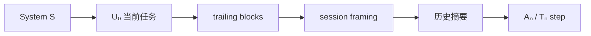

- **当前任务紧贴 S**：同 session 内多次 request 时，system + 任务指令前缀尽量不变，仅尾部 snapshot / 历史变化。
- **SESSION_HISTORY_FRAMING**：插在历史摘要前，用 Instruction/Context 声明「上文是当前任务，下文是背景」，避免续聊时把旧摘要当成新指令。
- 诊断模块中，`DiagnosticPrompts.routeStageUserPrompt` 将 **稳定路由指令置前**、**main session snapshot 置后**，与上述策略一致。

实现：`core/src/main/java/com/wish/models/context/PromptPrefixLayout.java`。

### 诊断模块（diagnostic）

诊断流程与单 Agent `run` 不同：由 **Router + 多 Stage** 协作，并在 **三个隔离 Context** 中组装提示词。实现见 `diagnostic/` 模块；CLI 用法见 [shell/docs/SHELL.md](../../shell/docs/SHELL.md#案例事故调查diagnostic)。

#### 三层 Context 与提示词职责

| Context | 存储 | System（S） | 主要 User 内容 | 是否跨 step 持久 |
|---------|------|-------------|----------------|------------------|
| **Main session** | `DiagnosticContext.mainSession` | `DIAGNOSTIC_SYSTEM` | `initialIncidentPrompt`（U₀）+ 各阶段 `stageFindingMessage` | 写入 **Session** 摘要与 incident 报告 |
| **Router** | `routeChatMemory`（独立 partition） | `ROUTER_SYSTEM` | 每轮 `routeStageUserPrompt` | **仅本轮 run**；`cleanupRun()` 清除 |
| **Stage** | `stageChatMemory`（每阶段新 partition） | `Stage.systemPrompt` | `stageTaskUserPrompt` + `stageBackgroundUserPrompt`（trailing） | **仅本阶段**；`endStage()` 清除 |

**边界原则**（见 `DiagnosticContext`）：

- Stage 内 tool trace **不回写** main session，仅通过 **`submit_stage_finding`** 将阶段结论贡献给主会话。
- Router 读取的 `mainSessionSnapshot` 是 **边界拷贝**，不进入 stage 的 ChatMemory。
- 多轮 `-c` 时，prior turns 经 `PromptPrefixLayout` hydrate 到 main session **尾部**（framing 之后），与 core Agent 续聊策略一致。

#### 调查循环与消息流

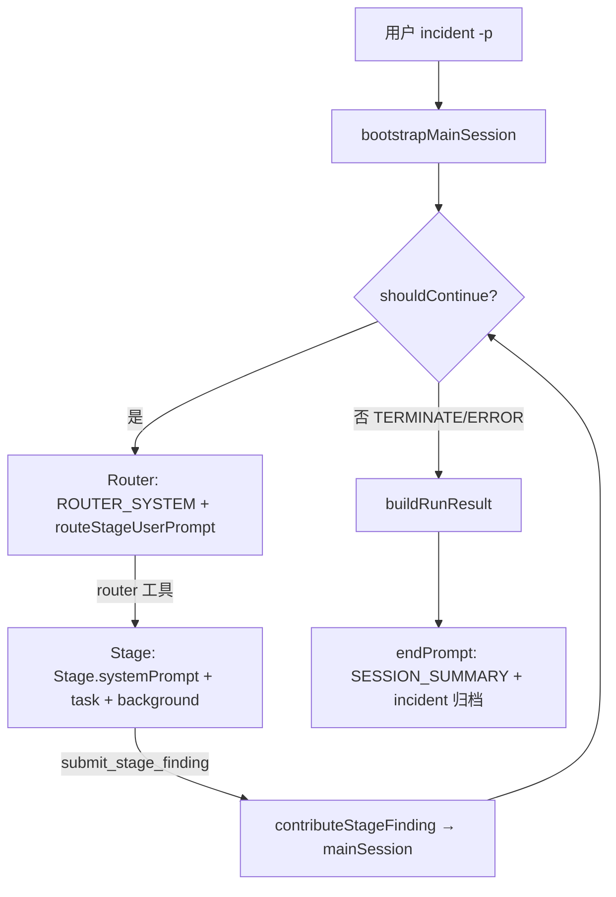

单阶段内 prefix 顺序（`StageProcessor` + `ToolCallAgent.run`）：

```text
S（Stage.systemPrompt）→ U₀（stageTaskUserPrompt）→ trailing（stageBackgroundUserPrompt）→ Uₙ/A/T（step loop）
```

与全局策略相同：**阶段任务指令（task）在前、可变 background snapshot 在后**，便于同一 stage 多 step 时 prefix cache 命中。

#### `DiagnosticPrompts` 常量

| 常量 | 用途 |
|------|------|
| `DIAGNOSTIC_SYSTEM` | Main session 协调者角色；区分 problem type vs root cause |
| `ROUTER_SYSTEM` | 阶段路由；仅允许调用 `router` 工具 |
| `routeStageUserPrompt` | 每轮路由 user 消息（progress + snapshot） |
| `initialIncidentPrompt` | 首次 incident 格式化为 U₀ |
| `stageTaskUserPrompt` / `stageBackgroundUserPrompt` | 阶段任务与只读背景拆分 |
| `stageFindingMessage` | 阶段结论写回 main session 的 UserMessage 模板 |
| `SESSION_SUMMARY_SYSTEM` | 多轮 Session 压缩（`DiagnosticSession`） |
| `INCIDENT_REPORT_SUMMARY_SYSTEM` | 单次调查归档报告（`IncidentReportArchiver`） |

结构化工具名（Output 交付约定）：

| 工具 | 阶段 | 含义 |
|------|------|------|
| `router` | Router | 选择下一 `Stage` |
| `classify_incident` | CLASSIFY | **问题类型**（symptom，非根因）；enum 见 `IncidentCategory.catalogForPrompt()` |
| `classify_root_cause` | COLLECT 及之后 | **根因**；可随证据更新；enum 见 `IncidentRootCause.catalogForPrompt()` |
| `submit_stage_finding` | 各 Stage | 阶段可见产出（等同 Janus 的 `create_chat_completion`） |
| `terminate` | 各 Stage | 结束本阶段 agent run |

`StageToolCallAgent` 将 `directSessionResultTool` 设为 `submit_stage_finding`，摘要器优先取其输出，而非 assistant 正文。

#### 阶段（Stage）提示词

每个 `Stage` enum 定义两类提示：

| 类型 | 方法/字段 | 说明 |
|------|-----------|------|
| **阶段 system** | `Stage.systemPrompt` | Role + Instruction + Rules + Output（如 CLASSIFY 强调「分 problem type，不分 root cause」） |
| **单步 nextStep** | `Stage.nextStepPrompt()` | Ephemeral；约束「本 turn 一个动作」及 `submit_stage_finding` → `terminate` 顺序 |

阶段顺序（Router 选择）：`INITIAL → CLASSIFY → COLLECT → ANALYZE → VALIDATE → TERMINATE | ERROR`。

**分类提示设计要点**（对应 Guide 中 classification 范例）：

- **Problem type** 与 **root cause** 分阶段、分工具，避免 CLASSIFY 阶段过早归因。
- enum 目录嵌入 Instruction（`Allowed problem types:` / `Allowed root causes:`），必要时可在 CLASSIFY 增加 few-shot 固定标签格式。

#### 摘要与归档（双 Summarizer）

| 路径 | System prompt | 触发 | 产出 |
|------|---------------|------|------|
| Session 续聊 | `SESSION_SUMMARY_SYSTEM` | `DiagnosticSession.endPrompt` | ChatMemory 中 2 条摘要 / 轮 |
| Incident 归档 | `INCIDENT_REPORT_SUMMARY_SYSTEM` | `IncidentReportArchiver.archiveRun` | `~/.janus/diagnostic-reports/` 下 `.md` / `.json` |

两者均通过 `PromptRunSummarizer` 生成；输入为 `getPromptMessagesForSummary()`（main session 本轮增量）+ run result，user 消息采用 **Instruction → Context → `Summary:`** 结构。

#### 修改诊断提示词时

1. 路由类文案改 `DiagnosticPrompts`；阶段行为改 `Stage` enum 或 `Stage.nextStepPrompt()`。
2. 保持 **snapshot / background 在 user 消息尾部**，并标注 `read-only`。
3. 阶段结论必须经 **`submit_stage_finding`**，不要依赖 assistant-only 文本进入 main session。
4. 跑 `diagnostic` 模块测试；core 侧 `PromptPrefixLayoutTest` 仍覆盖 shared prefix 逻辑。

### 代码中的提示词入口

| 场景 | 主要文件 |
|------|----------|
| 通用 / Janus / SWE / DA Agent | `core/.../agent/*.java`、`ToolCallAgent.java` |
| 规划 Flow | `core/.../flow/PlanningFlow.java` |
| Session 摘要 | `PromptRunSummarizer.java` + 各 Agent 的 `SESSION_SUMMARY_*` |
| 诊断主流程 / 路由 / 阶段文案 | `diagnostic/.../prompt/DiagnosticPrompts.java`、`model/stage/Stage.java` |
| 诊断 Context 边界与 main session | `diagnostic/.../model/DiagnosticContext.java` |
| 诊断执行循环 | `diagnostic/.../loop/DiagnosticAgent.java`、`StageProcessor.java`、`StageToolCallAgent.java` |
| 诊断 Session / 报告归档 | `diagnostic/.../models/session/DiagnosticSession.java`、`models/report/IncidentReportArchiver.java` |

新增或修改提示词时：

1. 采用 **Role → Instruction → Output/Rules**（system）或 **Instruction → Context/Input → Summary:**（user 摘要）。
2. 保持 **U₀ 简短明确**；大段只读材料放入 trailing block 或 Context 段，并标注 `read-only`。
3. **nextStepPrompt** 只写「本步一条最佳动作」，收敛规则（如「已 create_chat_completion 则仅 terminate」）放在 Rules。
4. 修改后跑相关测试：`PromptPrefixLayoutTest`、`AgentSessionSummaryPromptTest`、`PromptRunSummarizerTest` 等；诊断见 `diagnostic` 模块测试。

### 与 Memory 的协同

- **写入 Session 的**：每轮压缩后的 user request + agent result（及诊断 incident report），不是完整 step trace。
- **不写入 Session 的**：`nextStepPrompt`、路由/阶段内的 ephemeral 引导、原始 tool 日志（摘要 Rules 中要求省略）。
- 续聊歧义（把「继续」或系统 framing 当新任务）优先检查 session 是否过期；必要时 `clear-session`。见 [FAQ.md](../../docs/FAQ.md)。
